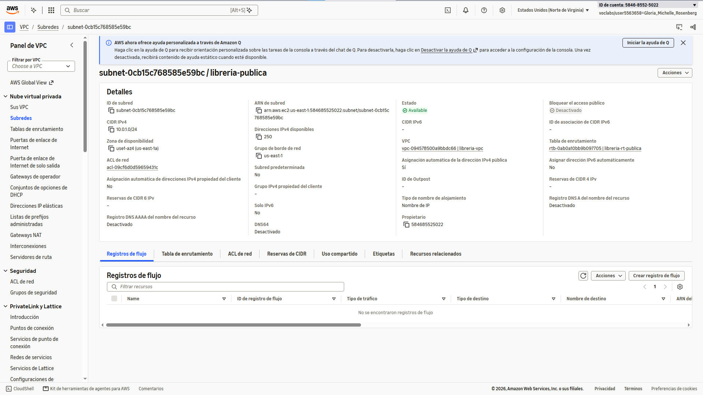
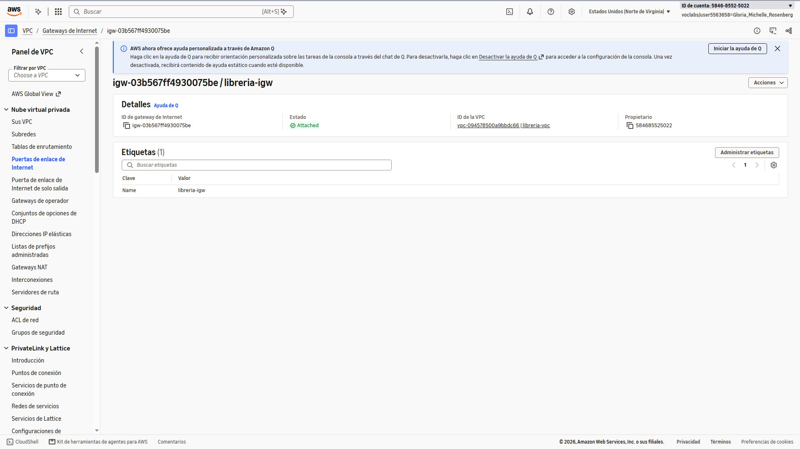
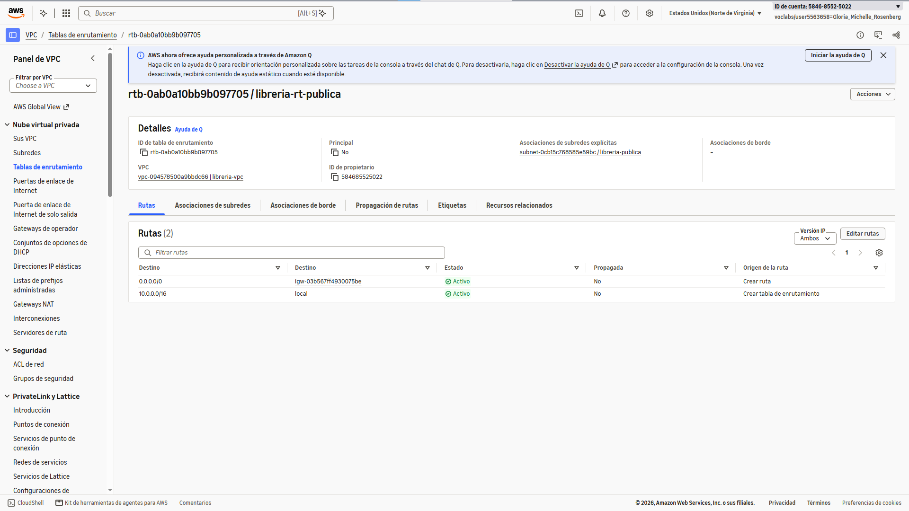
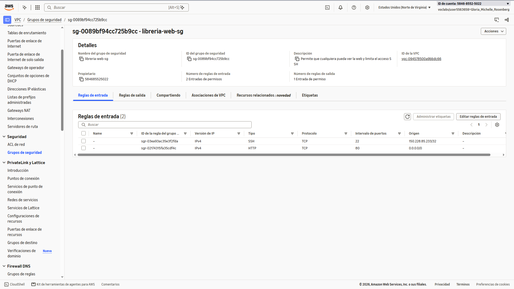
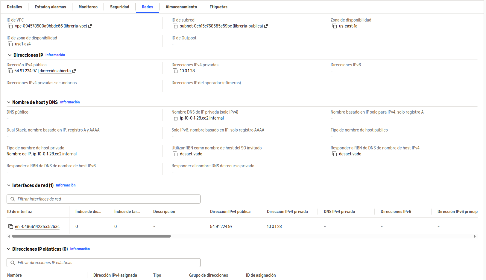
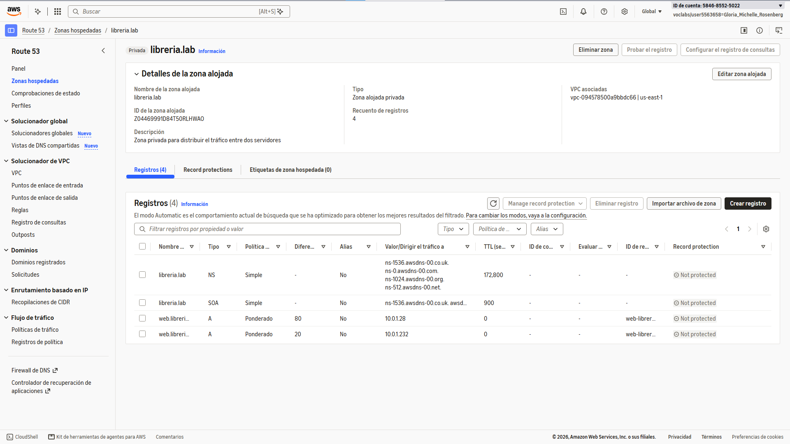
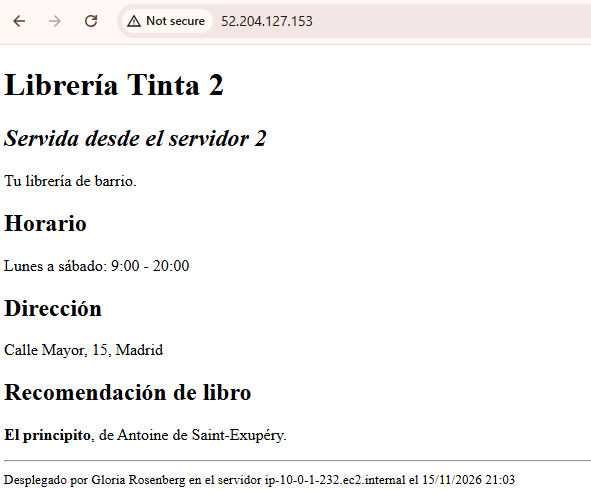
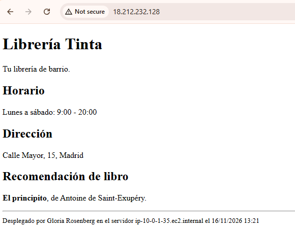

## Diagrama de la arquitectura (parte básica)

## Capturas de los recursos

VPC

Subred

Gateway

Tabla de rutas

Grupo de seguridad

EC2 (detalles)

EC2 (redes)

EC2 (etiquetas)

Route 53 con registros

## Capturas de las webs

**Captura de la web en la instancia EC2**

**Captura de la web en la segunda instancia EC2**

**Captura de la web creada desde CLI**

## Explicación sobre la subred pública y acceso a SSH

La subred es pública para que las personas puedan acceder al sitio web de la librería desde internet. El SSH solo se abre a mi IP porque soy la única persona que debería tener la posibilidad de conectarme a la máquina virtual y administrar la web.

## Explicación del presupuesto

[Enlace al presupuesto.](https://calculator.aws/#/estimate?id=b9cd4f483d03be475759052ee5cee6e287431db3)
Tener una máquina EC2 t3.micro encendida 24 horas al día, usando una dirección IP pública (que también se cobra) costaría unos 11,24 USD al mes. Tener dos máquinas encendidas, cada una con su IP pública, más un servicio DNS en Route 53, elevaría el coste a 22,98 USD al mes. Esta estimación no tiene en cuenta los posibles cobros por datos salientes.
La mejor manera de ahorrar costes sería apagar el servidor (detener, no terminar, la instancia) cuando no está en uso. Si los requisitos de rendimiento lo permiten, también se podría optar por un tipo de instancia menos potente como t3.nano.

## Enlace al video

[Enlace de YouTube](https://youtu.be/_xSLU2qtbpU)

## Uso de IA

La herramienta que usé como ayuda fue la versión gratuita de ChatGPT.
Un prompt que me resultó útil fue el de pedir una guía rápida de cómo formatear un archivo en markdown.
Otro prompt que me ayudó fue para clarificar qué recursos se cobraban entre los que se usaron en este proyecto, para saber qué incluir en el presupuesto.
Sin embargo, no me resultó del todo útil para ver dónde podía descargar la clave privada de vockey. No conseguí que ChatGPT me diera indicaciones claras sobre dónde encontrarla y al final encontré la respuesta en los apuntes de 'La terminal de AWS'. Intentar encontrar la respuesta con ChatGPT en este caso me hizo perder mucho tiempo comparado con si hubiese leído la guía de la terminal desde el principio.
También le pedí que me ayudara con un comando para guardar la IP pública de la máquina EC2 creada con el script en la parte avanzada. El comando que me dio fue correcto pero con en nombre de la variable y el ID de la instancia incorrectos (porque no se los había especificado yo), pero fue fácil sustituirlos con los valores correctos. También comprobé que el comando fuera parecido al que vi en la guía de la terminal.
