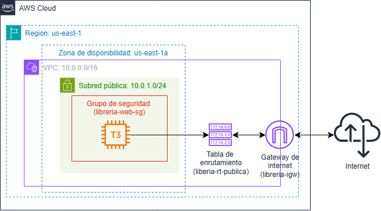
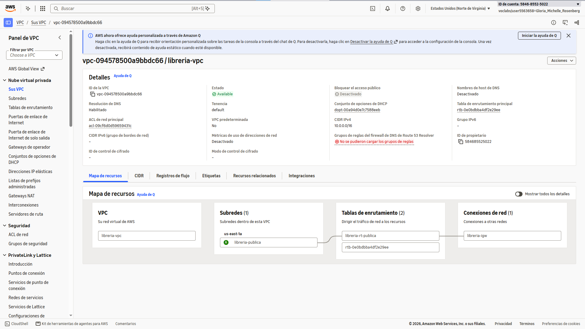
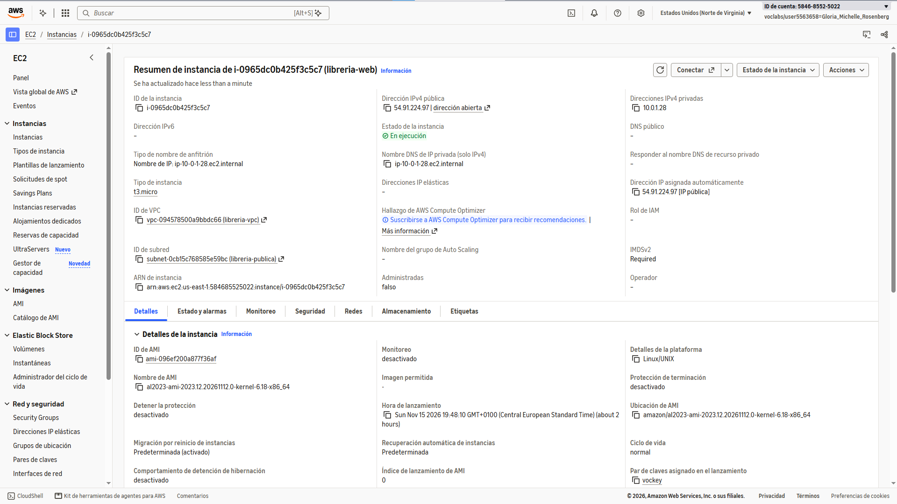
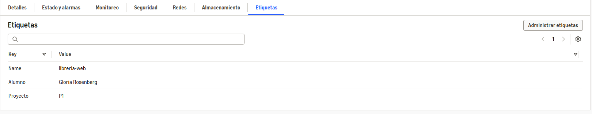
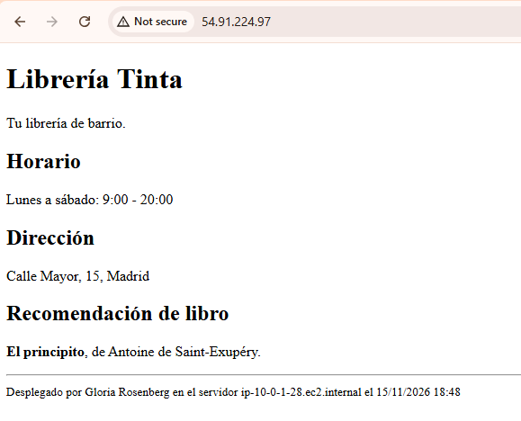

## Diagrama de la arquitectura

## Capturas de los recursos

## Capturas de las webs

## Explicación sobre la subred pública y acceso a SSH

La subred es pública para que las personas puedan acceder al sitio web de la librería desde internet. El SSH solo se abre a mi IP porque soy la única persona que debería tener la posibilidad de conectarme a la máquina virtual y administrar la web.

## Explicación del presupuesto

Tener la máquina EC2 t3.micro encendida 24 horas al día, usando una dirección IP pública (que también se cobra) costaría unos 11,24 USD al mes. [Enlace al presupuesto:](https://calculator.aws/#/estimate?id=b9cd4f483d03be475759052ee5cee6e287431db3). Esta estimación no tiene en cuenta los posibles cobros por datos salientes.
La mejor manera de ahorrar costes sería apagar el servidor (detener, no terminar, la instancia) cuando no está en uso. Si los requisitos de rendimiento lo permiten, también se podría optar por un tipo de instancia menos potente como t3.nano.

## Uso de IA

La herramienta que usé como ayuda fue la versión gratuita de ChatGPT.
Un prompt que me resultó útil fue el de pedir una guía rápida de cómo formatear un archivo en markdown.
Otro prompt que me ayudó fue para clarificar qué recursos se cobraban entre los que se usaron en este proyecto, para saber qué incluir en el presupuesto.
Realmente no me encontré ningún error o propuesta incorrecta usando ChatGPT para este proyecto, probablemente porque no lo usé mucho. Sí que he detectado errores en otras ocasiones al darme cuenta de lo que me decía la IA entraba en conflicto con lo que había aprendido.
